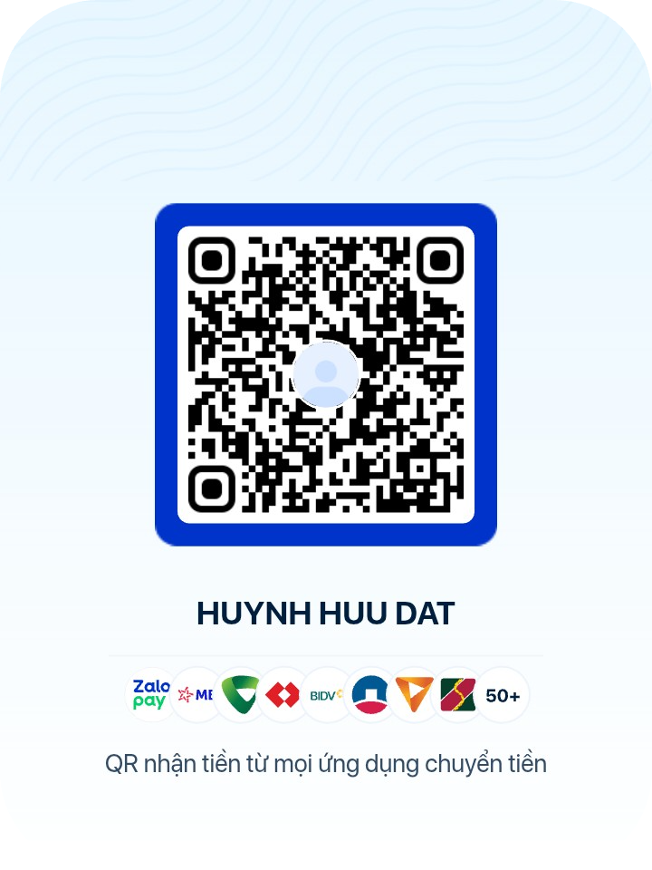

<div align="center">

## ⚡&nbsp;QR&nbsp;VIBE&nbsp;PRO&nbsp;MAX&nbsp;⚡ 
### **Biến mọi thứ thành mã QR cực nghệ chỉ trong 3 giây — Phong cách Chuẩn Gen Z**

[](https://hhd-z.github.io/CreateQRCode/)
[](#)
[](#)
[](./LICENSE)


<p align="center">
  <b>QR VIBE PRO MAX</b> là công cụ tạo mã QR thế hệ mới chạy trực tiếp trên trình duyệt (100% Client-side), không quảng cáo, không thu thập dữ liệu. Được thiết kế theo phong cách <b>Neo-Brutalism</b> rực rỡ, tối ưu hóa cho cả điện thoại và máy tính với khả năng quét nhạy tuyệt đối trên mọi dòng máy (iOS, Android, Zalo, Google Lens).
</p>

👉 **[TRẢI NGHIỆM NGAY TẠI: HHD-Z.GITHUB.IO/CREATEQRCODE](https://hhd-z.github.io/CreateQRCode/)** 👈

</div>

---

## 🔥 Điểm Nổi Bật Tạo Nên Sự Khác Biệt

Khác với các trang tạo QR thông thường dễ bị lỗi font chữ tiếng Việt hoặc chèn logo làm hỏng cấu trúc mã, **QR VIBE PRO MAX** sở hữu bộ lõi xử lý ma trận nâng cao:

- 🇻🇳 **Chuẩn mã hóa Byte UTF-8 Quốc Tế**: Giải quyết triệt để lỗi "máy quét được máy không" khi tạo văn bản tiếng Việt có dấu và biểu tượng cảm xúc (Emoji).
- 🎯 **Thuật toán Đục Rỗng Tâm Thông Minh (Smart Center Excavation)**: Tự động tính toán và dọn sạch các chấm dữ liệu bị cắt dở dưới gầm Logo, kết hợp nâng ma trận lên tối thiểu **Version 3** và bật mức chống lỗi tối đa **Mức H (30%)** giúp camera lấy nét cực nhanh.
- 🎨 **Giao diện Neo-Brutalism Độc Bản**: Viền đậm, đổ bóng khối sắc nét, tương thích hoàn hảo 100% trên màn hình cảm ứng điện thoại lẫn màn hình lớn.
- 🔒 **Bảo mật & Riêng tư tuyệt đối**: Mọi thao tác tạo mã đều diễn ra trực tiếp trên thiết bị của bạn, không gửi bất kỳ dữ liệu nào về máy chủ.

---

## ✨ Tính Năng Chính

### 1️⃣ 4 Chế Độ Tạo Mã QR Tách Biệt & Chuyên Sâu
| Chế độ | Mô tả chi tiết |
| :--- | :--- |
| 🔗 **Đường Dẫn (Link)** | Tự động thêm tiền tố `https://`, đi kèm các nút chọn nhanh mẫu mạng xã hội (Facebook, Instagram, TikTok, Shopee). |
| 📝 **Văn Bản (Chữ)** | Hỗ trợ gõ lời nhắn, số tài khoản ngân hàng, ghi chú mật khẩu bằng tiếng Việt có dấu kèm bộ đếm ký tự trực quan. |
| 📶 **Wi-Fi Tự Động** | Tạo mã QR kết nối thẳng vào mạng Wi-Fi (`WPA/WPA2/WPA3`, `WEP`, hoặc không mật khẩu) mà không cần gõ pass thủ công. |
| 🪪 **Danh Thiếp (vCard)** | Đóng gói Họ tên, Số điện thoại, Email, Công ty chuẩn `vCard 3.0` — quét 1 chạm là lưu ngay vào danh bạ điện thoại. |

### 2️⃣ Độ Chế Giao Diện & Màu Sắc Đa Dạng
- **Tùy chỉnh màu sắc tự do**: Chọn màu chấm QR (Foreground) và màu nền (Background) theo mã Hex bất kỳ.
- **6 Bảng màu Vibe dựng sẵn**: *Kinh điển, Tím Mộng Mơ, Hồng Cháy Phố, Xanh Mint, Ocean Chill, Retro Nâu*.
- **Tùy chỉnh độ phân giải cao**: Kéo thanh trượt xuất ảnh nét căng từ `300x300 px` lên tới `800x800 px`.
- **4 Mức độ chống lỗi (Error Correction)**: Tùy chọn linh hoạt giữa `L (7%)`, `M (15%)`, `Q (25%)` và `H (30%)`.

### 3️⃣ Kho Chèn Logo, Icon Vector & Huy Hiệu Chữ Ở Giữa
- 😎 **Kho Emoji Gen Z & Icon Vector**: Gắn nhanh hàng chục biểu tượng (🔥, ✨, 👑, 💸, 🚀, 🧋, Web, Wi-Fi, Shop, Tim...) chỉ với 1 chạm.
- 🔤 **Tạo Huy Hiệu Chữ Tùy Chỉnh**: Nhập trực tiếp chữ viết tắt tối đa 4 ký tự (VD: `VIP`, `SẾP`, `YÊU`, `2K6`) để đóng dấu thương hiệu cá nhân.
- 🖼️ **Tải Ảnh Cá Nhân**: Hỗ trợ tải lên logo thương hiệu hoặc ảnh đại diện từ máy (`PNG`, `JPG`, `WEBP`).
- 📐 **Độ Khung Viền Logo**: Đổi kiểu khung (*Bo góc, Tròn, Hình thoi*), chỉnh màu nền khung, màu chữ và tăng giảm kích cỡ logo từ `14%` đến `24%`.

### 4️⃣ Xuất File & Chia Sẻ Tức Thì
- 📥 **Tải ảnh PNG chất lượng cao**: Lưu trực tiếp về thư viện ảnh trên điện thoại hoặc máy tính.
- 📋 **Sao chép thẳng vào Clipboard**: Copy nhanh hình ảnh mã QR để dán (`Ctrl + V` / `Paste`) ngay vào khung chat Zalo, Messenger, Telegram.

---

## 🛠️ Công Nghệ Sử Dụng (Tech Stack)

- **HTML5 & CSS3 (Custom Neo-Brutalism System)**: Hệ thống biến CSS tự chủ, đảm bảo giao diện luôn giữ vững bố cục ngay cả khi mạng chậm.
- **Tailwind CSS (CDN)**: Hỗ trợ căn chỉnh Responsive linh hoạt trên mọi kích thước màn hình.
- **JavaScript (ES6+ Canvas API)**: Xử lý vẽ ma trận điểm ảnh, đục lỗ tâm QR và kết xuất huy hiệu Vector/Emoji trực tiếp trên `<canvas>`.
- **QRCode-Generator (`1.4.4`)**: Thư viện tính toán ma trận QR hỗ trợ chế độ `UTF-8 Byte`.
- **Phosphor Icons & Google Fonts**: Bộ icon sắc nét kết hợp cùng cặp font chữ hiện đại `Space Grotesk` & `Plus Jakarta Sans`.

---

## 🚀 Hướng Dẫn Cài Đặt & Chạy Thử Trên Máy (Local)

Dự án được đóng gói theo kiến trúc **Single-File Application** cực kỳ gọn nhẹ, bạn không cần cài đặt Node.js hay bất kỳ thư viện phức tạp nào:

1. **Clone kho lưu trữ này về máy:**
   ```bash
   git clone https://github.com/hhd-z/CreateQRCode.git
   ```
2. **Mở thư mục dự án:**
   ```bash
   cd CreateQRCode
   ```
3. **Khởi chạy ngay lập tức:**
   - Nhấp đúp chuột vào file `index.html` (hoặc `qr-generator.html`) để mở trực tiếp trên trình duyệt (Chrome, Safari, Edge, Firefox...).
   - Hoặc chạy thông qua tiện ích **Live Server** trên VS Code.

---

## 📸 Mẹo Quét QR Luôn Nhạy 100%

- Luôn ưu tiên **Màu chấm QR đậm hơn Màu nền** (độ tương phản cao giúp camera nhận diện nhanh trong điều kiện thiếu sáng).
- Khi chèn Logo hoặc Chữ ở tâm, hệ thống đã tự động khóa mức chống lỗi ở **Tối đa (H - 30%)**, bạn có thể yên tâm sử dụng cho in ấn tem nhãn, menu quán cà phê hoặc bảng thanh toán.

---

<div align="center">

### Made with Gemini 4 argon ❤️ & Vibe by **[Me](https://github.com/hhd-z)**
Nếu bạn thấy dự án này hữu ích và xịn xò, đừng quên tặng cho repo một ngôi sao ⭐ trên GitHub nhé, và hỗ trợ tác giả nhá!



</div>
